# 2.1. 안전펜스 (Safety Fence)

안전펜스는 원하는 영역에 마우스를 클릭하여 신속하게 펜스 형상을 만들고, 모서리 위치에 좌표값을 타이핑하여 정밀하게 레이아웃을 조정할 수 있는 확장 모델입니다.

모델 불러오기로 라이브러리의 `Jig - Fence`를 불러옵니다.
     

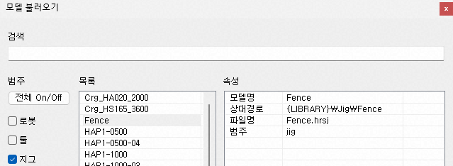

3D화면에는 아직 아무 것도 나타나지 않습니다. 트리창에 생성된 모델에 대해 팝업 메뉴에서 확장 속성을 선택하여 안전펜스 속성 대화상자를 여십시오. (혹은 모델 속성 대화상자에서,  버튼을 클릭해도 됩니다.)
 
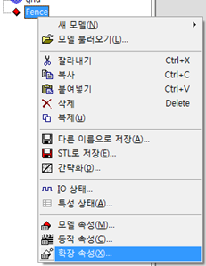

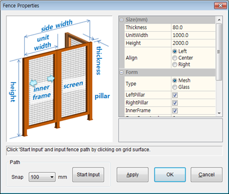

마우스로 꼭지점 위치들을 클릭하여 펜스 경로를 입력할 수 있습니다. 우선 꼭지점의 좌표값을 정확히 하기 위한 snap 값을 선택하십시오. 이 예에서는 100mm를 선택했습니다.
`Start Input` 버튼을 눌러 놓고, 마우스로 3D 화면의 grid 표면에 꼭지점들을 좌버튼 클릭하십시오. 클릭한 지점들 사이에 펜스가 생성됩니다. 아래 그림은 7개의 지점을 클릭하여 펜스를 생성한 예입니다.

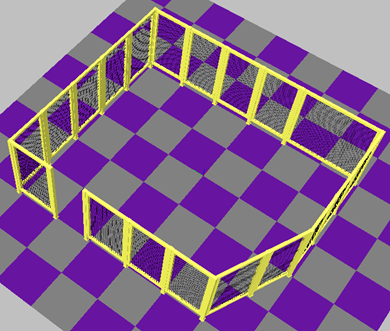

`End Input` 버튼을 누르면, 경로 입력이 종료됩니다. 입력된 좌표값들은 펜스 속성의 `FencePath` 범주에서 확인하고, 설계에 맞게 정밀 수정할 수 있습니다.

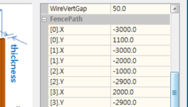
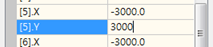

원하는 좌표값을 더블 클릭하여 수정한 후, `Apply` 버튼을 클릭하면 3D화면에 반영됩니다.
(`Start Input` 버튼을 다시 누르면, 펜스경로를 처음부터 재입력하게 됩니다.)

다양한 펜스 속성들을 수정하여 펜스의 타입, 높이, 두께, 철망의 색상, 간격 등을 변경할 수 있습니다. 아래 예는 아까 생성한 철망 타입의 펜스를 유리 타입으로 변경한 예입니다. 스크린(유리)의 색상은 붉은 색, 투명도를 70%로 하여, 아크 용접 셀을 묘사했습니다. (펜스 프레임의 색상은 `리본 메뉴 - 스타일`에서 변경할 수 있습니다.)

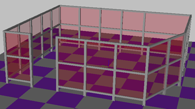

펜스 사이 열린 공간에 출입문을 만들어 봅시다. 기존 펜스의 자식으로서 모델 불러오기로 펜스 1개를 생성하고 이름을 변경합니다.

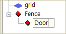

새 펜스(출입문)의 확장 속성을 열고 `Start Input` 버튼을 누르십시오. 마우스 좌클릭으로 grid 표면에 2개의 좌표를 지정한 후, `End Input` 버튼을 누르십시오.

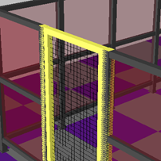
->
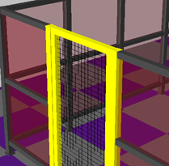

펜스의 기둥과 출입문의 기둥이 겹치면 위 좌측 그림처럼 부자연스럽게 보일 수 있습니다. 펜스의 `LeftPillar`, `RightPillar` 속성의 체크를 제거하여 펜스의 가장자리 기둥을 제거하십시오.

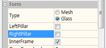

출입문의 확장 속성과 스타일을 수정하여, 펜스와 유사한 형태로 만드십시오. 마지막으로 `DoorOpenAngle` 속성에 적당한 문 열림 각도(deg.)를 입력하면 출입문이 완성됩니다. 이제 프로젝트 파일을 저장하십시오.

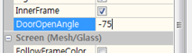
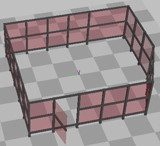

