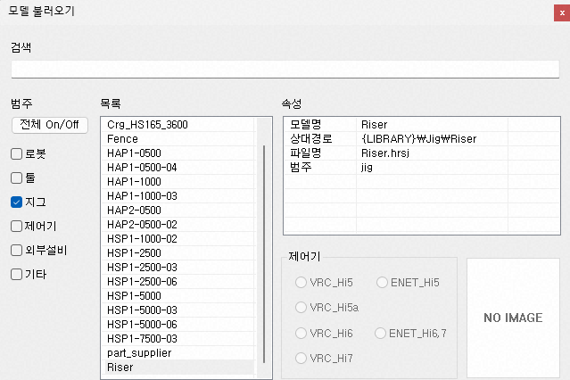
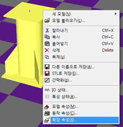
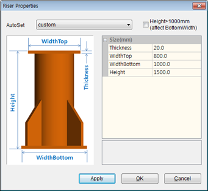
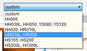
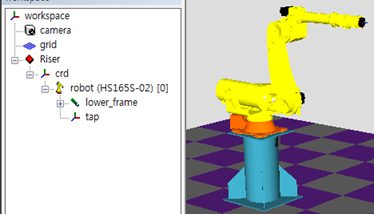

# 2.2 로봇 보고대 (Robot Riser)

로봇 보고대는 몇 가지 주요 수치를 입력하여 원하는 크기의 보고대 형상을 신속하게 만들 수 있는 확장 모델입니다. 

모델 불러오기로 라이브러리의 `Jig - Riser`를 불러옵니다.

디폴트 파라미터로 로봇 보고대 모델이 생성됩니다. 생성된 모델에 대해 팝업 메뉴에서 확장 속성을 선택하여 보고대 속성 대화상자를 여십시오.

대화상자 우측에 크기 속성들이 제공됩니다. `AutoSet` 드롭다운 리스트 박스에서 로봇 타입을 선택하면 그에 맞는 보고대 크기로 속성값들이 자동 설정됩니다.

 
보고대가 높을수록 안정성을 위해 하단 판넬의 면적이 커야 합니다. 보고대 높이가 1000mm이상일 경우, `Height>1000mm` 체크박스를 켜면 `WidthBottom` 값이 적절히 설정됩니다. (수작업으로 설정해도 됩니다.)

보고대 상단 표면에는 `crd`라는 이름의 좌표계 모델이 있습니다. 이 좌표계의 자식 모델로서 로봇을 불러오기 하면, 상단 표면에 정확히 로봇이 설치됩니다. (혹은, 트리창에서 이미 불러온 로봇을 마우스 왼쪽 버튼으로 드래그하여 `crd`에 드롭해도 됩니다.)

