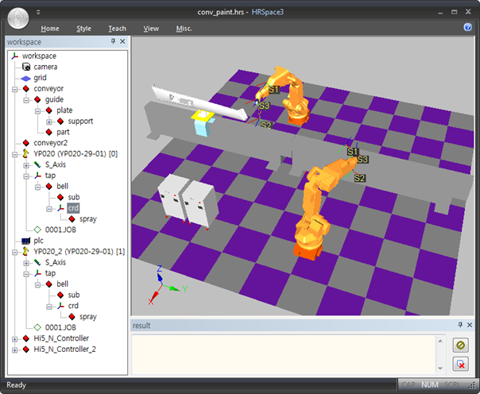
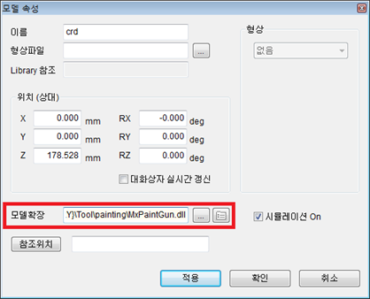
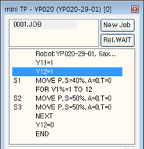
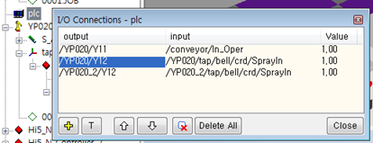
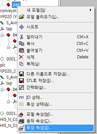
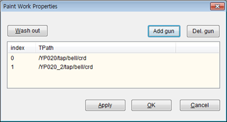
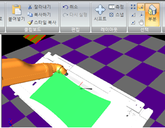
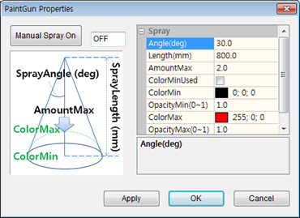
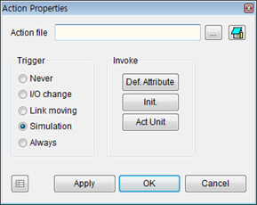
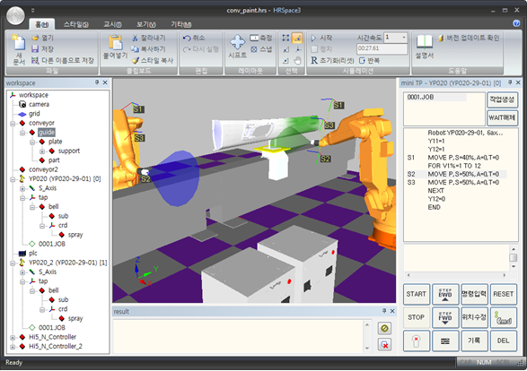

# 2.3. Paint Gun, Paint Work

Using the paint gun and the paint work extension model, the simulation visually represents the formation of the coating on the surface of the 3D workpiece. It helps to determine whether the coating is not formed in certain areas of the workpiece or is excessively overlapped.


The painting application feature is only available on the Hi5a controller, and it is currently not available on Hi6/Hi7.


Let’s assume that a workspace like the one below has been created, and we will add the coating formation function in this state. The workspace has two YP020 units, each equipped with the paint gun (`tap/bell`). The workpiece (`part`) on the shuttle (`/conveyor/guide`) moves between the robots, and the paint discharged from the two paint guns must form a coating on the surface of this workpiece.

First, connect the `MxPaintGun.DLL` library to each of the two paint gun models.

1. Open the model property dialog for `/YP020/tap/bell/crd`.
2. Click the  button to the right of the model extension input field.
3. Select `/Library/Tool/painting/MxPaintGun.dll`.
4. Click the `OK` button.
5. Apply the same settings for `/YP020_2/tap/bell/crd`.

Connect the `MxPaintWork.DLL` library to the workpiece model.

1. Open the model property dialog for `/conveyor/guide/part`.
2. Click the  button to the right of the model extension input field.
3. Select `/Library/Tool/painting/MxPaintWork.dll`.
4. Click the `OK` button.

Connect the paint gun to be ON/OFF based on the robot's output signal. If, for example, the paint gun is controlled by the `Y12` output signal, create an I/O connection model to connect the `Y12` output of both robots to the `SprayIn` input signal of each paint gun.

Now, open the extension property dialog for the paint work item `/conveyor/guide/part`.

First, you need to specify the guns to be used for painting. Press the `Add gun` button and specify the T paths for the two paint guns as shown below.

Next is the specification regarding the paint faces. A single workpiece can consist of one or more faces. Click on the faces of the workpiece where the painting will be performed using the mouse after pressing the `Ribbon Menu - Home - Parts` button in HRSpace. If the workpiece consists of only one face, you can skip face selection. (If it is an STL file shape, there is only one face.)

Click the `Add sel. Faces` button to register the selected faces, and the number of registered faces will be displayed in the dialog box. Pressing the `Clear` button will remove all registrations. If the mesh of the CAD shape is not sufficiently small, the visual precision of the coating may be reduced when it is formed, so you may want to divide the mesh into smaller pieces before registering faces. Check `sub-div.` and set the length (mm); this will divide the mesh to lengths less than this value. (Note that the smaller the length, the greater the memory consumption and computation time.)

In the case of a single face, checking `auto for single select` allows the registration process to be performed automatically when the HRSpace project is opened. This is a feature you can use if you want to open the project and immediately see the coating formation simulation by pressing the play button.

Before forming the coating, you can adjust the unique material color and transparency of the workpiece by selecting the model and adjusting it in the style group of the ribbon menu.

Open the extension properties of the paint gun `/YP020/tap/bell/crd` and set the painting parameters. The meanings of each property are as follows.

<table>
<tr>
    <th>Property Name</th>
    <th>Description</th>
    <th>Unit, Range</th>
</tr>
<tr>
    <td>Angle</td>
    <td>The spray angle of the paint. (The angle from the center of the cone to the slope)</td>
    <td>deg</td>
</tr>
<tr>
    <td>Length</td>
    <td>The spray distance of the paint. (The height of the cone)</td>
    <td>mm</td>
</tr>
<tr>
    <td>AmountMax</td>
    <td>The maximum thickness of the coating that can be formed.</td>
    <td>No unit</td>
</tr>
<tr>
    <td>ColorMinUsed</td>
    <td>Whether to use the minimum color. If not checked, ColorMin and OpacityMin will be ignored.</td>
    <td></td>
</tr>
<tr>
    <td>ColorMin</td>
    <td>Minimum color. Set the color to be displayed when the paint thickness is at its minimum using RGB values.</td>
    <td>RGB values 0~255 each</td>
</tr>
<tr>
    <td>OpacityMin</td>
    <td>Minimum opacity. Set the opacity for the minimum paint thickness using RGB values.</td>
    <td>0~1</td>
</tr>
<tr>
    <td>ColorMax</td>
    <td>Maximum color. Set the color to be displayed when the paint thickness is at its maximum (AmountMax) using RGB values.</td>
    <td>RGB values 0~255 each</td>
</tr>
<tr>
    <td>OpacityMax</td>
    <td>Maximum opacity. Set the opacity for the maximum paint thickness (AmountMax) using RGB values.</td>
    <td>0~1</td>
</tr>
</table>

When paint is continuously sprayed at a certain point on the workpiece surface, the thickness data value of that point continuously increases internally. However, once the thickness reaches the AmountMax setting, it no longer increases.

The thickness data value of the workpiece surface is expressed in an appropriate color depending on whether the ColorMinUsed property is checked, as shown in the table below.

<table>
<tr>
    <th>ColorMinUsed</th>
    <th>Color Representation</th>
</tr>
<tr>
    <td>Checked, (Minimum color used)</td>
    <td>
    - When the paint thickness is minimum, the color and opacity specified by ColorMin and OpacityMin are used for representation. 
    - When the paint thickness is maximum (AmountMax), the color and opacity specified by ColorMax and OpacityMax are used for representation. 
    - The color and opacity transition gradually from minimum to maximum thickness.
    </td>
</tr>
<tr>
    <td>Unchecked, (Minimum color not used)</td>
    <td>
    - When the paint thickness is minimum, the unique color and opacity of the workpiece are used for representation. 
    - When the paint thickness is maximum (AmountMax), the color and opacity specified by ColorMax and OpacityMax are used for representation. 
    - The color and opacity transition gradually from minimum to maximum thickness.
    </td>
</tr>
</table>

Open the extension properties dialog for `/conveyor/guide/part`. To ensure the coating formation occurs only during the simulation, set the execution timing to `Simulation`. If you want the coating formation to occur even when not in simulation, set it to `Always`.

Now that the setup is complete, perform the simulation. When the `Y12` signal becomes ON, the paint gun will turn ON, and the discharge of the paint will be represented as a translucent conical shape of the `ColorMax` color. You will be able to see how the coating forms where the cone overlaps with the workpiece `/conveyor/guide/part`.

When performing the simulation again, click the `Wash out` button in the workpiece's extension properties dialog to clear the coating color applied to the workpiece.