# 2.4. Path Generation Z (PathGenZ)

Based on the shape of the 3D workpiece imported into the workspace, this function automatically generates a zigzag path for the workpiece surface (face).

In general, the robot path for painting operations proceeds in a zigzag shape as shown in the figure below. To conveniently adjust the direction of progress and the distance to the workpiece surface, the `PathGenZ` module is represented as a virtual plane object called the `projection-plane`. This plane can be freely moved and rotated using the `Gizmo` function of HRSpace, just like other HRSpace models.

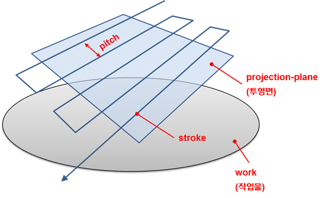

As shown in the figure, each straight path crossing the projection plane is referred to as a stroke, and the distance between strokes is called the pitch. These strokes create a path projected onto the surface of the object like a shadow.
Additionally, for a clean painting operation, there must be waypoint steps outside the edges of the workpiece. The distances between the edge and the waypoint steps are referred to as the `inward-offset` and `outward-offset`, represented as shown in the figure below.

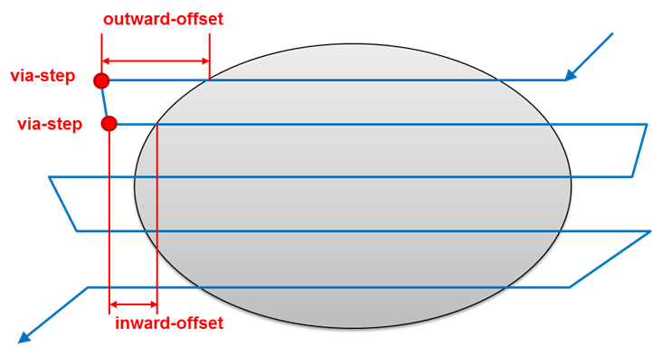

Assuming the workspace is prepared as follows: one painting robot (YP020) and one painting workpiece (part) are placed, the tool is set to `tcp1`, and an empty work program (0005.JOB) has been created. The paint gun output signal (`/YP020/Y5`) is connected to the paint gun (bell) attached to the robot to visualize the coating. A T path for the paint gun has been specified for the painting workpiece (part). (For details on the coating visualization settings, refer to Section 2.3.)

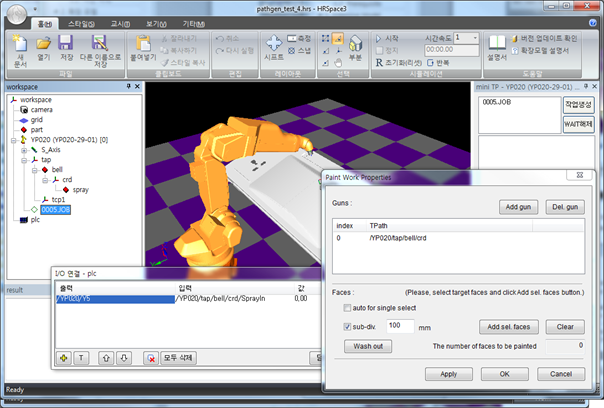

First, load the path generation model `{LIBRARY}/PathGen/PathGenZ` into the workspace. Turn on the shift function and position the projection plane parallel to a suitable distance from the workpiece.

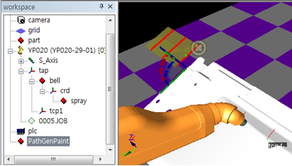

One workpiece is composed of one or more faces. Press the `Ribbon Menu - Home - Part` button and click on the faces to be painted on the workpiece with the mouse.

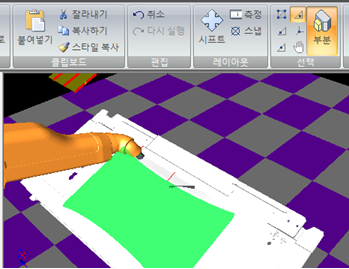

Open the `Path Generator Z Properties`. Click the `Add work` button and input the T path of the workpiece.

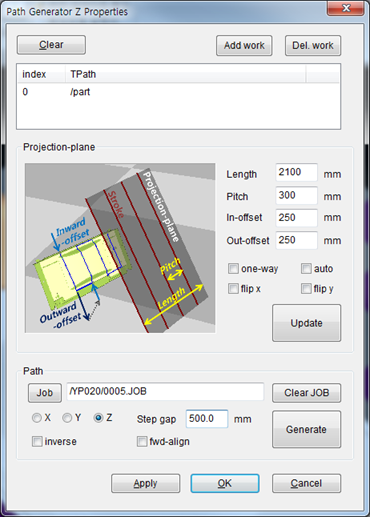

Now, refer to the dialog box and the table below to set the properties in the `Projection-plane` group box, and press the `Apply` button to reflect changes on the 3D screen.

<table>
<tr>
    <th>Property Name</th>
    <th>Description</th>
    <th>Unit, Range</th>
</tr>
<tr>
    <td>Length</td>
    <td>The length of the projection plane (in the vertical direction of the stroke line segment). The path will proceed only this distance. 
(The length of the stroke line segment is considered infinite.)</td>
    <td>mm >0</td>
</tr>
<tr>
    <td>Pitch</td>
    <td>The distance between strokes.</td>
    <td>mm >0</td>
</tr>
<tr>
    <td>In-offset</td>
    <td>Inward-offset Distance between the inward waypoint step and the edge of the workpiece.</td>
    <td>mm >0</td>
</tr>
<tr>
    <td>Out-offset</td>
    <td>Outward-offset Distance between the outward waypoint step and the edge of the workpiece.</td>
    <td>mm >0</td>
</tr>
<tr>
    <td>One-way</td>
    <td>Whether to generate painting paths only in one direction 
        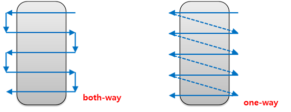
    </td>
    <td></td>
</tr>
<tr>
    <td>auto</td>
    <td>Whether to perform the Update operation automatically at regular intervals. 
        (Turning it On may slow down operation.)</td>
    <td></td>
</tr>
<tr>
    <td>flip x</td>
    <td>Whether to flip the path in the X direction.</td>
    <td></td>
</tr>
<tr>
    <td>flip y</td>
    <td>Whether to flip the path in the Y direction.</td>
    <td></td>
</tr>
</table>

Clicking the `Update` button will project the specified properties and display the strokes projected onto the surface of the workpiece. Adjust the size and direction of the transparent surface using the shift function, and create appropriate projected strokes on the surface of the workpiece by adjusting the stroke width and spacing as properties.

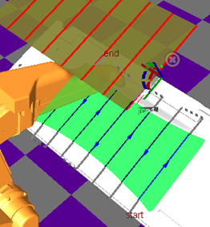

After pressing the Job button, select the work program in the tree view where the steps will be generated. The properties related to step generation are explained in the table below.

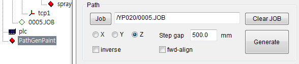

<table>
<tr>
    <th>Property Name</th>
    <th>Description</th>
    <th>Unit, Range</th>
</tr>
<tr>
    <td>X, Y, Z</td><td>The orthogonal axes of the tool aligned with the direction of paint discharge (perpendicular to the workpiece surface).</td><td></td>
</tr>
<tr>
    <td>inverse</td><td>Whether to set the orthogonal axes of the tool in the opposite direction.</td><td></td>
</tr>
<tr>
    <td>fwd-align</td><td>forward-align Whether to align a different axis from the selected orthogonal axes in X, Y, Z with the forward direction of the TCP.</td><td></td>
</tr>
<tr>
    <td>Step gap</td>
    <td>The minimum distance between steps. The smaller this value, the more steps are created when steps are generated on the curved surface.</td>
    <td>mm>0</td>
</tr>
</table>

From the `Ribbon Menu - Teach Tab` of HRSpace, set the parameters and reference coordinate system for the steps to be created. Especially, take care that the tool number matches the TCP specified for the spray distance of the paint gun. In the example, the tool number is set to 1 since it is `tcp1`.

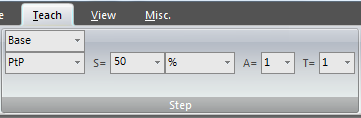

Clicking the `Generate` button will create steps and painting commands in the designated work program.

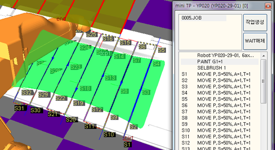

If you want to regenerate the work program by adjusting property values, first click the `Clear JOB` button to delete the generated steps, and then click the `Generate` button.
The figure below shows the simulation being performed along with the coating formation explained in Section 2.3.

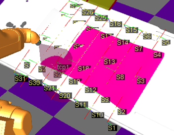