# 2.5. 바닥도면 (Floor Plan)

바닥도면은 HRSpace 바닥에 CAD의 도면파일(.dxf)을 매핑하여, 신속한 배치 작업을 도와줄 수 있는 확장 모델입니다.

모델 불러오기로 라이브러리의 `FloorPlan`을 불러옵니다.

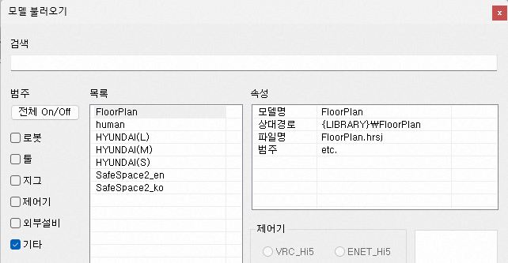

3D화면에는 아직 아무 것도 나타나지 않습니다. 트리창에 생성된 모델(FloorPlan)에 대해 팝업 메뉴에서 확장 속성을 선택하여 바닥도면 속성 대화상자를 여십시오. (혹은 모델 속성 대화상자에서,  버튼을 클릭해도 됩니다.)

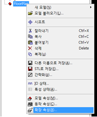
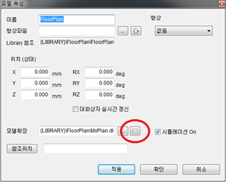

파일 경로를 입력해줍니다. (혹은 파일 경로 입력란 우측의 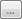 버튼을 클릭해서 해당 위치의 파일을 선택해도 됩니다.)

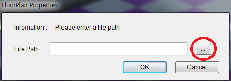

[Ok] 버튼을 눌러줍니다.

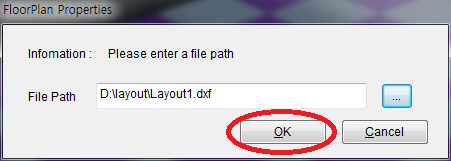

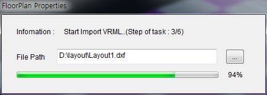

파일 로딩이 완료되면, 팝업 된 메시지 박스에 정보가 출력됩니다.

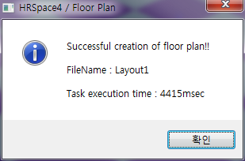

불러들인 도면을 확인 할 수 있습니다.

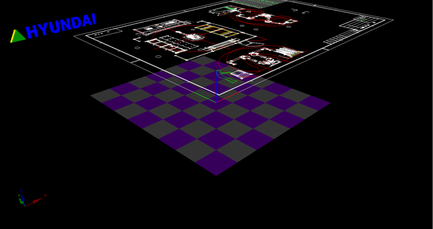

(파일의 용량이 크면 도면을 불러들이는 데에 수십 초가 걸릴 수도 있습니다.)

 
 기능을 사용하여 도면의 위치를 이동하여, 도면의 위치를 HRSpace의 원점과 적절히 일치시킵니다.

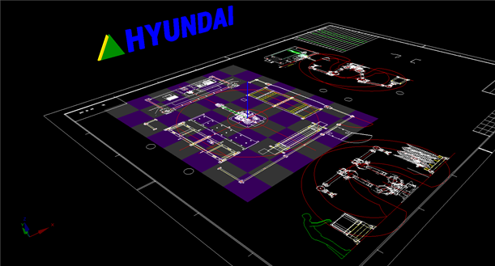

바닥에 전시된 도면을 참고하며 배치 작업을 수행 합니다.

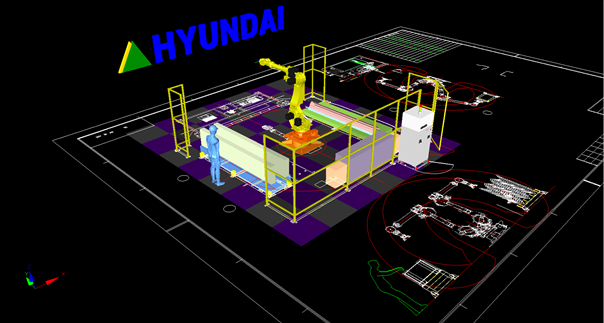

 
바닥도면 확장모델은 다음과 같은 기능상 제약이 있습니다.

1. 색상 변환
- HRSpace에 표시되는 도면의 색상이 원본과 일치하지 않을 수 있습니다.

<table>
<tr>
  <th>AutoCAD 화면</th>
  <th>HRSpace 화면</th>
</tr>
<tr>
  <td>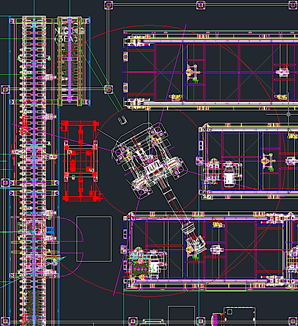</td>
  <td>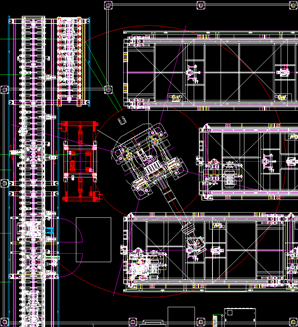</td>
</tr>
</table>

2. Text 미지원
- Text는 표시되지 않습니다.

<table>
<tr>
  <th>AutoCAD 화면</th>
  <th>HRSpace 화면</th>
</tr>
<tr>
  <td>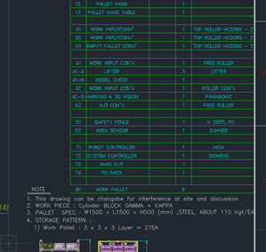</td>
  <td>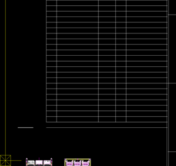</td>
</tr>
</table>
