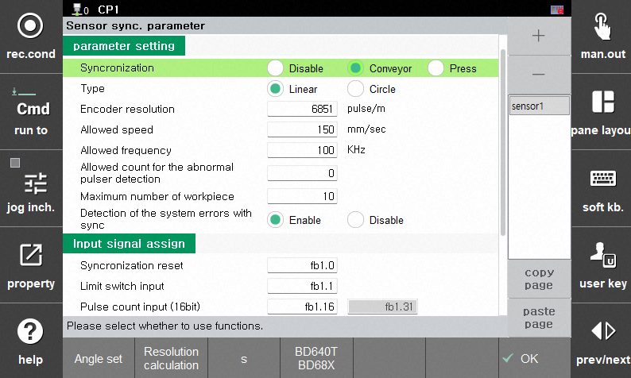

# 2.6. Conveyor Sync

- Please read the `Sensor Sync` manual first. 
  * Hi5a Controller Function Manual - Sensor Sync
  * [Hi6 Controller Function Manual - Sensor Sync (Conveyor, Press)](https://hrbook-hrc.web.app/#/view/doc-sensor-sync/en/README?cont_model=Hi6)
  * [Hi7 Controller Function Manual - Sensor Sync (Conveyor, Press)](https://hrbook-hrc.web.app/#/view/doc-sensor-sync/en/README?cont_model=Hi7)


The Hi6/Hi7 conveyor synchronization feature is supported starting from HRSpace v4.10.0.


The conveyor sync extension model is an extension model in HRSpace that generates the Pulse Count and Limit Switch output of a conveyor and transmits them to the VRC, enabling conveyor synchronization simulation.

Import `conveyor`, `conveyor_CCW (Counterclockwise Curve)`, or `conveyor_CW (Clockwise Curve)` from the external equipment library using `Load Model`.

## 2.6.1. Extension Properties Dialog

Open the Conveyor Properties dialog by selecting `Extension Properties...` from the pop-up menu for the created model (conveyor) in the tree window. (You can also click the  button in the `Model Properties` dialog.) 

The roles of each button are as follows:

| Button Name | Role |
|-----------|----------------------------------------------------------|
| `start` | Starts the conveyor. `pulse cnt.` starts to increase. |
| `stop` | Decelerates and stops the conveyor. |
| `reset` | Resets the pulse count and workpiece position to 0, bringing it to a stopped state. It also outputs the `SyncReset` signal as a 500ms single pulse. |
| `put` | Starts moving the workpiece on the conveyor. |
| `J+`/`J-` | Jog buttons that move the conveyor forward or backward when stopped. |
| `CCW`/`CW` | Displayed only for Curve-type conveyors. Selects Counterclockwise (CCW) / Clockwise (CW). |

- By default, the workpiece is a rectangular box shape named `target`. If necessary, adjust the `Model Properties` to set the desired size, height, basic shape, or shape files such as STL. However, the name must remain `target`.

You can configure the properties below in the table at the bottom. Settings are applied only after clicking the `Apply` button, and they can also be configured during operation.

| Property Name |            Description                               |
|-----------|----------------------------------------------------------|
| `Stroke` | Workpiece outfeed position. Re-initialized to position 0 when `target` reaches this point. |
| `Resolution` | Encoder resolution. Set this to the same value calculated and configured automatically in VRC in the procedure below |
| `Speed` | Target speed of the conveyor. |
| `Accel` | Acceleration of the conveyor. |
| `Decel` | Deceleration of the conveyor. |
| `LS position` | Limit switch position. When `target` reaches this point in the forward direction, the `LimitSwitch` signal and `LS` lamp turn on for 300ms.|

## 2.6.2. Conveyor Settings 

Referring to [Sensor Sync Parameter Settings](https://hrbook-hrc.web.app/#/view/doc-sensor-sync/en/3-user-interface/3-3-sensor-sync-parameter?cont_model=Hi7), first set the sync state on the `Sensor Sync Parameter` screen of VTP to `Conveyor`, and set the conveyor type to `Linear` or `Circle`.

### Controller Input Connection

The robot controller performs operations in exact synchronization with the position of the workpiece on the conveyor. To achieve this, the robot controller receives the following 3 pieces of information as inputs from the conveyor to estimate the position of the workpiece. (Since the robot controller has 2 input channels, it can connect with up to 2 conveyors.)

- `SyncReset`: Considers the current conveyor pulse input value as workpiece position 0. (1bit)
- `LimitSwitch`: Reference position information of the workpiece (1bit) that turns ON when a workpiece moving along the conveyor activates a limit switch, such as an optical sensor.
- `PulseCount`: Pulse information used to calculate the real-time speed of the conveyor (16bit).

The method of receiving these 3 pieces of information varies depending on the controller model.

- Hi5a Controller
  * Dedicated Conveyor I/F Board (BD585)
- Hi6/Hi7 Controller (Supports 2 methods)
  * Dedicated Conveyor I/F Board (BD641T, BD681)
  * Crevis FnIO Module M5112: Inputted as user input (di, diw).

The conveyor model in the HRSpace virtual space must transmit the above 3 pieces of information to the Virtual Robot Controller (VRC) just like an actual conveyor. The connection method is as follows:

- Dedicated Conveyor I/F Board

  Assign the TPath of the conveyor model to the Pulse Counter item in `Robot Properties - Sync`. It is transferred internally without needing a virtual I/O connection.
  
  
 

- FnIO Module Method

  Set the assigned signals for `Syncronization reset`, `Limit switch input`, and `Pulse counter input (16bit)` under `Input Signal Assign` group on the `Sensor sync parameter` screen of VTP.

  After creating an `I/O Connection` object in the workspace, open its properties and configure it. Connect the 3 output values of the conveyor model (`SyncReset`, `LimitSwitch`, `PulseCount`) to the respective `di` areas configured in VTP.

  * Important: Since these output values must be transmitted to the VRC at a fast cycle, be sure to check the `Realtime` checkbox.

  

Open the `Sensor Sync` monitoring panel of VTP and verify if the pulse count and speed are displayed identically to those in the Extension Properties dialog. If confirmed, it is connected properly.

### Limit Switch and Outfeed Position

- Check the appropriate workpiece outfeed position, then enter the position value into the `Stroke` property.
- Check the appropriate position to place the limit switch, then enter the position value into the `LS position` property.
  * When the workpiece passes the limit switch, check if `Limit Switch Input` in the `Sensor Sync` monitoring panel of VTP momentarily changes to 1 and whether `Entered Workpiece Count` increases.

### Conveyor Angle

Referring to the Sensor Sync manual, perform the automatic conveyor angle setting in the virtual space using VTP. (You can execute this while moving the workpiece using the `J+`, `J-`, or `start`, `stop` buttons in the Conveyor Properties dialog.)

### Encoder Resolution

Referring to the Sensor Sync manual, perform the automatic conveyor encoder resolution setting in the virtual space using VTP. Enter the same value as the configured encoder resolution in the `Resolution` field of the Extension Properties dialog, then click the `Apply` button to reflect it.

### Saving

Once each setting is completed, save the entire HRSpace project.

## 2.6.3. Teaching

Referring to the Sensor Sync manual, teach the conveyor sync operation.
Position the workpiece at a suitable location using the `J+` and `J-` buttons, then perform teaching for the workpiece while the conveyor is stopped.

## 2.6.4. Conveyor Sync Simulation

Initialize the conveyor and workpiece position using the `reset` button, start the conveyor using the `start` button, and dispatch the workpiece from the initial position using the `put` button.
When the taught job is executed, the robot will wait at the `cv.wait` statement (for Hi6/Hi7). Once the workpiece reaches the limit switch position, the robot starts the conveyor sync operation.

## 2.6.5. Ethernet Data Transmission to Actual Hi5a Controller

If you set `Robot Properties - Controller connection` to `ENetHi5`, the `PulseCount` property value and `LimitSwitch` I/O values are also transmitted to the actual Hi5a controller via Ethernet. (Hi6/Hi7 are not supported.)

