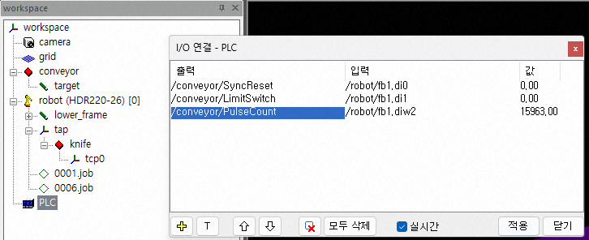
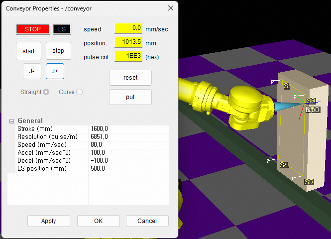
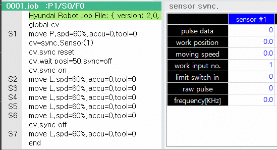

# 2.6. 컨베이어 동기 (Conveyor Sync)

-	`센서 동기` 기능설명서를 먼저 숙지해주십시오. 
  *	Hi5a 제어기 기능설명서 - 센서 동기
  * [Hi6 제어기 기능설명서 - 센서 동기(컨베이어, 프레스)](https://hrbook-hrc.web.app/#/view/doc-sensor-sync/ko/README?cont_model=Hi6)
  * [Hi7 제어기 기능설명서 - 센서 동기(컨베이어, 프레스)](https://hrbook-hrc.web.app/#/view/doc-sensor-sync/ko/README?cont_model=Hi7)


Hi6/Hi7의 컨베이어 동기화 기능은 HRSpace v4.10.0 부터 지원합니다.


컨베이어 동기화 확장모델은 HRSpace 에서 컨베이어의 Pulse Count와 Limit Switch 출력을 생성해 VRC에 전달함으로써, 컨베이어 동기화 시뮬레이션이 가능하게 해주는 확장 모델입니다.

`모델 불러오기`로 라이브러리의 외부설비에서 `conveyor`(직선) 또는, `conveyor_CCW`(반시계 방향 커브) 또는, `conveyor_CW`(시계방향 커브)를 불러옵니다.

## 2.6.1. 확장 속성 대화상자

트리창에 생성된 모델(conveyor)에 대해 팝업 메뉴에서 `확장 속성...`을 선택하여 컨베이어 속성 대화상자를 여십시오. (`모델 속성` 대화상자에서,  버튼을 클릭해도 됩니다.) 

각 버튼의 역할은 아래와 같습니다.

|   버튼명   |                   역할                                   |
|-----------|----------------------------------------------------------|
|  `start`  | 컨베이어를 가동합니다. `pulse cnt.`가 증가하기 시작합니다.     |
|  `stop`   | 컨베이어를 감속 정지합니다.                                  |
|  `reset`  | 펄스 카운트와 작업물의 위치를 0으로 리셋하여 정지상태로 만듭니다. 또한 `SyncReset` 신호를 500ms 단일 펄스로 출력합니다. |
|  `put`    | 컨베이어 상의 작업물 이동을 시작합니다.                       |
| `J+`/`J-` | 정지 상태일 때 컨베이어를 전진 혹은 후진 시키는 조그 버튼입니다.  |
| `CCW`/`CW` | Curve 타입 컨베이어일 때만 표시됩니다. 반시계 방향(CCW)/시계방향(CW)을 선택합니다. |

- 기본적으로 작업물은 `target`이라는 이름의 직육면체 형상입니다. 필요 시, `모델 속성`을 조정하여 원하는 크기와 높이, 기본 형상, 혹은 STL 등 형상파일을 설정해도 됩니다. 단, 이름은 반드시 `target`을 유지해야 합니다.

하단의 테이블에서 아래의 속성들을 설정할 수 있습니다. 설정은 `Apply` 버튼을 클릭해야 적용되며, 동작 중에도 설정 가능합니다.

|   속성명   |                   설명                                   |
|-----------|----------------------------------------------------------|
| `Stroke` | 작업물 아웃피드(outfeed) 위치. `target`이 도달하면 0 위치로 재초기화됩니다. |
| `Resolution` | 엔코더 분해능. 아래 절차에서 VRC로 자동 계산해 설정한 것과 동일한 값으로 설정하십시오. |
| `Speed`  | 컨베이어의 목표 속도.                                        |
| `Accel`   | 컨베이어의 가속도.                                          |
| `Decel`   | 컨베이어의 감속도.                                          |
| `LS position` | 리밋 스위치 위치. `target`이 이 지점에 순방향으로 도달하면 `LimitSwitch` 신호와 `LS` 램프가 300ms간 켜집니다.|

## 2.6.2. 컨베이어 설정 

[센서 동기 파라미터 설정](https://hrbook-hrc.web.app/#/view/doc-sensor-sync/ko/3-user-interface/3-3-sensor-sync-parameter?cont_model=Hi7) 을 참고하여, 우선 VTP의 `센서 동기 파라미터` 화면의 동기 상태를 `컨베이어`로 설정하고, 컨베이어 형태를 `직선` 혹은 `원형`으로 설정하십시오.

### 제어기 입력 연결

로봇 제어기는 컨베이어 상의 작업물의 위치에 정확히 동기하여 작업을 수행합니다. 이를 위해 로봇 제어기는 컨베이어로부터 다음의 3가지 정보를 입력 받아, 작업물의 위치를 추정합니다. (로봇 제어기의 입력 채널이 2개이므로, 최대 2개의 컨베이어와 연결할 수 있습니다.)

- 동기 리셋 (`SyncReset`) : 현재 컨베이어 펄스 입력값을 작업물 위치 0으로 간주. (1bit)
- 리밋 스위치 (`LimitSwitch`) : 컨베이어 상에서 흘러가는 작업물이 광학 센서 등 리밋 스위치를 작동시킬 때 ON 되는 작업물의 기준 위치 정보 (1bit).
- 펄스 카운트 (`PulseCount`) : 컨베이어의 실시간 속도 계산에 사용되는 펄스 정보 (16bit).

위 3가지 정보를 전달받는 방식은 제어기 모델에 따라 차이가 있습니다.

- Hi5a 제어기
  * 전용 컨베이어 I/F 보드(BD585)
- Hi6/Hi7 제어기 (2가지 방법 지원)
  * 전용 컨베이어 I/F 보드
  * Crevis社의 FnIO 모듈 M5112 : user input (di, diw)로 입력됨.

HRSpace 가상공간의 컨베이어 모델은 실제의 컨베이어와 같이 위 3가지 정보를 가상 로봇제어기(VRC)로 전달해야 합니다. 연결방법은 아래와 같습니다.

- 전용 컨베이어 I/F 보드

  conveyor 모델의 TPath를 `로봇 속성-동기`의 펄스 카운터 항목에 지정해 줍니다. 가상 I/O 연결 필요 없이 내부적으로 전달됩니다.
  
  
 

- FnIO 모듈 방식

  VTP의 `센서 동기 파라미터` 화면의 `입력 신호 할당` 그룹에 `동기 리셋 입력`, `리밋스위치 입력`, `펄스카운터 입력 (16bit) 할당 신호를 설정하십시오.

  workspace에 `I/O 연결` 객체를 생성한 후, 속성을 열고 설정해줍니다. conveyor 모델의 `SyncReset`, `LimitSwitch`, `PulseCount`, 3개의 출력값을 VTP에 설정했던 di 영역에 각기 연결시켜주면 됩니다.

  * 중요 : 이 출력값들은 빠른 주기로 VRC에 전달되어야 하므로, 반드시 `실시간` 체크박스를 체크해주십시오.

  

VTP의 `센서 동기` 모니터링 판넬을 열어 확장 속성 대화상자의 펄스카운트와 속도가 동일하게 표시되는지 확인되었다면 정상적으로 연결된 것입니다.

### 리밋 스위치와 아웃피드(outfeed) 위치

- 적절한 작업물 아웃피드(outfeed) 위치를 확인 한 후 `Stroke` 속성에 위치 값을 입력하십시오.
- 리밋 스위치를 배치할 적절한 위치를 확인 한 후, `LS position` 속성에 위치 값을 입력하십시오.
  * 작업물이 리밋 스위치를 지날 때, VTP의 `센서 동기` 모니터링 판넬의 `리밋 스위치 입력`이 순간적으로 1로 바뀌는지와 `진입 작업물 개수`가 증가하는지를 확인하십시오.

### 컨베이어 각도

센서 동기 기능설명서를 참고하여, 가상공간 내에서 컨베이어 각도 자동 설정을 VTP로 수행하십시오. (컨베이어 속성 대화상자의 `J+`, `J-`, 혹은 `start`, `stop` 버튼으로 작업물을 움직여가며 수행하면 됩니다.)

### 엔코더 분해능

센서 동기 기능설명서를 참고하여, 가상공간 내에서 컨베이어 엔코더 분해능 자동 설정을 VTP로 수행하십시오. 설정된 엔코더 분해능과 동일한 값을 확장 속성 대화상자의 `Resolution` 항목에도 입력한 후 `Apply` 버튼을 클릭해 반영하십시오.

### 저장

각 설정이 끝나면 HRSpace 프로젝트 전체를 저장하십시오.

## 2.6.3. 교시

센서 동기 기능설명서를 참고하여, 컨베이어 동기 작업을 교시하십시오.
`J+`, `J-` 버튼을 사용해 작업물을 적당한 위치에 배치한 후, 컨베이어 정지 상태에서 작업물에 대한 교시를 수행합니다.

## 2.6.4. 컨베이어 동기 시뮬레이션

`reset` 버튼으로 컨베이어와 작업물 위치를 초기화 한 후, `start` 버튼으로 컨베이어를 가동하고, `put` 버튼으로 작업물을 초기 위치에서 출발시키십시오.
교시된 job을 기동하면, 로봇은 (Hi6/Hi7 기준) `cv.wait` 명령문에서 대기할 것입니다. 작업물이 리밋 스위치 위치에 도달하면, 로봇이 컨베이어 동기 작업을 시작합니다.

## 2.6.5. 실제 Hi5a 제어기로의 이더넷 데이터 전달 

`로봇 속성 - 제어기 연결`을 `ENetHi5`로 설정하면 `PulseCount` 특성 값과 `LimitSwitch` I/O 값이 이더넷을 통해 실제 Hi5a 제어기로도 전달됩니다. (Hi6/Hi7은 지원하지 않습니다.)

