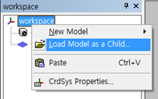
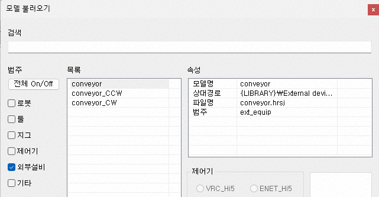
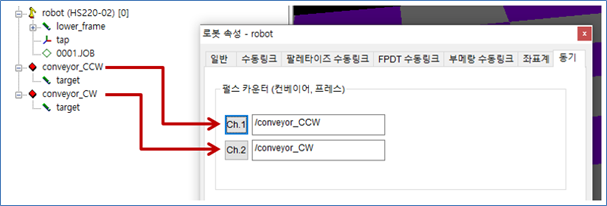
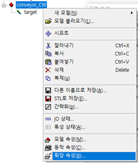
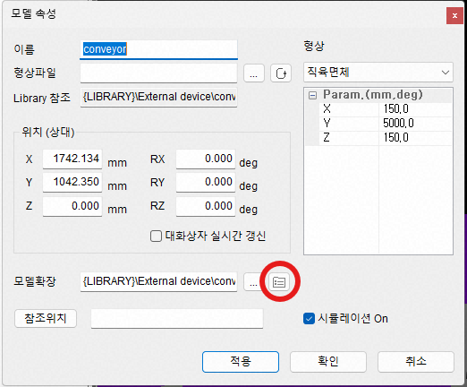
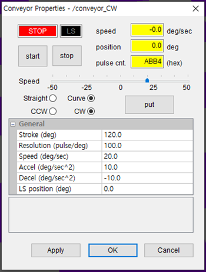
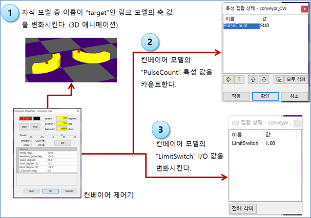
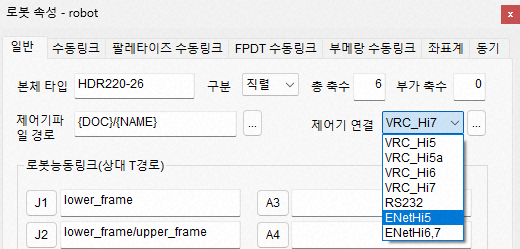
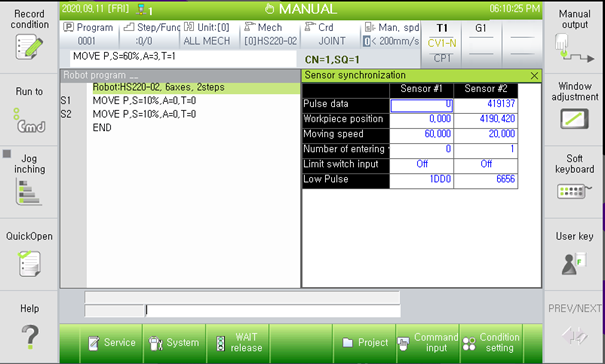

# 2.6. Conveyor Sync

- Please familiarize yourself with the use of the "Sensor Sync" feature first.
  * Hi5a Controller Function Manual - Sensor Sync
  * [Hi6 Controller Function Manual - Sensor Sync (Conveyor, Press)](https://hrbook-hrc.web.app/#/view/doc-sensor-sync/en/README?cont_model=Hi6)
  * [Hi7 Controller Function Manual - Sensor Sync (Conveyor, Press)](https://hrbook-hrc.web.app/#/view/doc-sensor-sync/en/README?cont_model=Hi7)

The Conveyor Sync expansion model helps simulate conveyor synchronization by generating the Pulse and Limit Switch values of the conveyor in HRSpace and transmitting those values to the VRC or Ethernet simulator.

Load `Conveyor (Linear)` or `conveyor_CCW (Counterclockwise Circular)` or `conveyor_CW (Clockwise Circular)` from the external equipment in the library using the model loading feature.

Specify the TPath of the designated MXConveyor expansion model in the Pulse Counter section of `Robot Properties - Sync`.

For the created model (FloorPlan) in the tree view, select the expansion properties from the popup menu to open the conveyor properties dialog. (You can also click the  button in the model properties dialog.)

Click `START` in the properties dialog to start the conveyor operation.  
Click the `put` button to begin the Target's operation.

## 2.6.1. Operation of the Conveyor

## 2.6.2. Data Transmission to Hi5a Controller

The `PulseCount` characteristic value and `LimitSwitch` I/O value are transmitted to the virtual controller or the Ethernet-connected controller according to the settings in the robot properties for controller connection.

The transmitted values can be monitored on the sensor sync screen. (Please refer to the "Sensor Sync" user guide for the Hi5a controller.)

